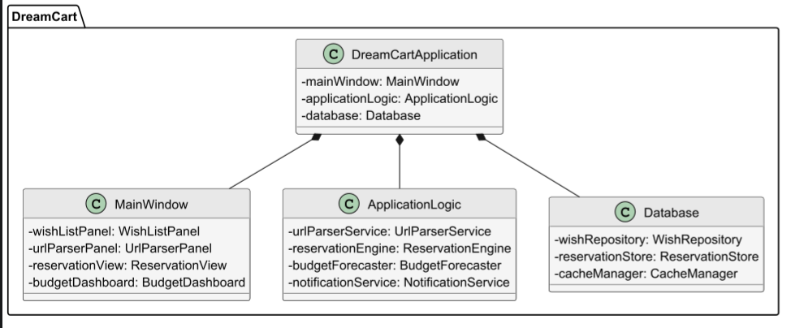
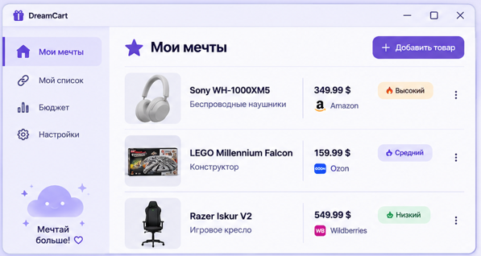
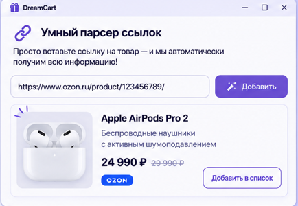

# Спецификация требований к ПО
## DreamCart — приложение для управления желаниями и накоплениями

**Версия:** 0.1  
**Подготовил:** Кожин Максим Мамиконович  
**Организация:** БГУИР
**Дата изменения:** 05.11.2026
## Оглавление

<!-- TOC -->
* [1. Введение](#1-introduction)
  * [1.1 Назначение документа](#11-document-purpose)
  * [1.2 Область применения продукта](#12-product-scope)
  * [1.3 Определения, акронимы и сокращения](#13-definitions-acronyms-and-abbreviations)
  * [1.4 Ссылки](#14-references)
  * [1.5 Обзор документа](#15-document-overview)
* [2. Обзор продукта](#2-product-overview)
  * [2.1 Перспектива продукта](#21-product-perspective)
  * [2.2 Функции продукта](#22-product-functions)
  * [2.3 Ограничения продукта](#23-product-constraints)
  * [2.4 Характеристики пользователей](#24-user-characteristics)
  * [2.5 Допущения и зависимости](#25-assumptions-and-dependencies)
  * [2.6 Распределение требований](#26-apportioning-of-requirements)
* [3. Требования](#3-requirements)
  * [3.1 Внешние интерфейсы](#31-external-interfaces)
    * [3.1.1 Пользовательские интерфейсы](#311-user-interfaces)
    * [3.1.2 Аппаратные интерфейсы](#312-hardware-interfaces)
    * [3.1.3 Программные интерфейсы](#313-software-interfaces)
  * [3.2 Функциональные требования](#32-functional)
  * [3.3 Качество обслуживания](#33-quality-of-service)
    * [3.3.1 Производительность](#331-performance)
    * [3.3.2 Безопасность](#332-security)
    * [3.3.3 Надёжность](#333-reliability)
    * [3.3.4 Доступность](#334-availability)
    * [3.3.5 Наблюдаемость](#335-observability)
  * [3.4 Соответствие стандартам](#34-compliance)
  * [3.5 Проектирование и реализация](#35-design-and-implementation)
    * [3.5.1 Установка](#351-installation)
    * [3.5.2 Сборка и поставка](#352-build-and-delivery)
    * [3.5.3 Распределение](#353-distribution)
    * [3.5.4 Сопровождаемость](#354-maintainability)
    * [3.5.5 Повторное использование](#355-reusability)
    * [3.5.6 Переносимость](#356-portability)
    * [3.5.7 Стоимость](#357-cost)
    * [3.5.8 Сроки](#358-deadline)
    * [3.5.9 Доказательство концепции](#359-proof-of-concept)
    * [3.5.10 Управление изменениями](#3510-change-management)
  * [3.6 ИИ/МО](#36-aiml)
    * [3.6.1 Спецификация модели](#361-model-specification)
    * [3.6.2 Управление данными](#362-data-management)
    * [3.6.3 Ограничители (Guardrails)](#363-guardrails)
    * [3.6.4 Этика](#364-ethics)
    * [3.6.5 Human-in-the-Loop](#365-human-in-the-loop)
    * [3.6.6 Жизненный цикл модели и операции](#366-model-lifecycle-and-operations)
* [4. Верификация](#4-verification)
* [5. Приложения](#5-appendixes)
<!-- TOC -->
## История изменений 
| Name | Date | Reason For Changes | Version |
|------|------|--------------------|---------|
| Кожин М.М | 05.11.2026 | docs: Add SRS and mockup for DreamCart | 0.1 |
| Кожин М.М | 05.11.2026 | docs: Fix srs | 0.2 |
| Кожин М.М | 05.11.2026 | fix images | 0.4 |
| Кожин М.М | 06.11.2026 | updated docs srs | 0.5 |
| Владыковский Н. Д. | 06.11.2026 | fixed version history  | 0.6 |

## 1. Введение

Документ определяет требования к DreamCart — приложению для ведения списка желаний, планирования накоплений и анонимного бронирования подарков. Спецификация предназначена для разработчика, тестировщика и руководителя учебного проекта. Она фиксирует ожидаемое поведение и характеристики продукта, служит основой для проектирования, реализации и проверки.

### 1.1 Назначение документа

Цель SRS — определить, **что** должно делать приложение DreamCart, а также критерии, по которым можно проверить соответствие реализации ожиданиям. Документ используется на этапах разработки, тестирования и приёмки продукта. Он не заменяет архитектурную и пользовательскую документацию, а дополняет их.

### 1.2 Область применения продукта

DreamCart версии 0.1 позволяет пользователю собирать товары из интернет-магазинов в единый список желаний, отслеживать накопления и делиться списком с другими людьми. Пользователь может добавить товар вручную или вставить ссылку на его страницу; приложение пытается извлечь название, изображение, текущую цену и магазин с помощью Java и библиотеки Jsoup.

Ключевые функции продукта — управление желаниями, финансовый прогноз даты покупки, создание публичной ссылки и QR-кода, а также анонимное бронирование подарков. Владелец списка видит статус «Забронировано», но не видит личность забронировавшего. Оплата товаров, доставка и управление аккаунтами интернет-магазинов в область версии 0.1 не входят.

### 1.3 Определения, акронимы и сокращения

| Термин | Определение |
|---|---|
| API | Application Programming Interface — программный интерфейс взаимодействия |
| Бронирование | Отметка посетителя о намерении подарить выбранный товар |
| DreamCart | Приложение для управления желаниями и накоплениями |
| Jsoup | Java-библиотека для загрузки и разбора HTML-документов |
| Парсер ссылок | Компонент извлечения сведений о товаре из веб-страницы |
| Публичный список | Список желаний, доступный по специальной ссылке или QR-коду |
| SRS | Software Requirements Specification — спецификация требований к ПО |
| UI | User Interface — пользовательский интерфейс |
| Secret Reservation | Режим анонимного бронирования подарка |
| Budget Forecast | Расчёт предполагаемой даты покупки |

### 1.4 Ссылки

| Источник | Назначение | Статус |
|---|---|---|
| Концепция DreamCart, предоставленная автором | Назначение и основные возможности | Основной источник |
| Диаграмма классов DreamCart, предоставленная автором | Компоненты и связи системы | Основной источник |
| Документация Java | Справка по платформе Java | Справочный |
| Документация Jsoup | Справка по разбору HTML | Справочный |

Версии Java, Jsoup и СУБД должны быть зафиксированы в проектной документации перед выпуском итоговой сборки.

### 1.5 Обзор документа

Раздел 1 описывает назначение и область применения продукта. Раздел 2 раскрывает контекст, функции, ограничения, пользователей и зависимости. Раздел 3 содержит требования к интерфейсам, функциям, качеству и реализации. Раздел 4 определяет методы проверки, а раздел 5 содержит дополнительные сведения об архитектуре и пользовательских сценариях. Изменения фиксируются в истории версий.

## 2. Обзор продукта

### 2.1 Перспектива продукта

DreamCart является самостоятельным программным продуктом. Согласно диаграмме, класс `DreamCartApplication` связывает главное окно `MainWindow`, прикладную логику `ApplicationLogic` и слой хранения `Database`.

`MainWindow` объединяет панели списка желаний, парсера ссылок, бронирования и финансовой панели. `ApplicationLogic` координирует `UrlParserService`, `ReservationEngine`, `BudgetForecaster` и `NotificationService`. Компонент `Database` предоставляет доступ к `WishRepository`, `ReservationStore` и `CacheManager`.

Приложение получает сведения о товарах с внешних сайтов. Их доступность и изменение HTML-разметки могут влиять на работу парсера. Владелец продукта, SLA и служба поддержки в исходной концепции не определены.

### 2.2 Функции продукта

1. Создание, просмотр, редактирование и удаление желаний.
2. Добавление товара по ссылке с извлечением названия, изображения, цены и магазина.
3. Ручное добавление и исправление данных, если парсинг не удался.
4. Назначение приоритета каждому желанию.
5. Учёт накопленной суммы и отображение прогресса покупки.
6. Указание ежемесячного бюджета и расчёт ориентировочной даты покупки.
7. Создание публичной ссылки и QR-кода для списка.
8. Анонимное бронирование товара посетителем публичного списка.
9. Отображение статусов и уведомлений о результатах операций.

### 2.3 Ограничения продукта

- Приложение должно быть реализовано на Java.
- Для разбора HTML-страниц должна использоваться библиотека Jsoup.
- Парсинг возможен только для доступных страниц с распознаваемой разметкой.
- CAPTCHA, авторизация, динамическая загрузка и изменение структуры сайта могут препятствовать извлечению данных.
- Приложение не должно обходить механизмы защиты интернет-магазинов.
- Полученные автоматически данные должны быть доступны пользователю для проверки и исправления.
- Владелец списка не должен видеть личность забронировавшего.
- Приложение не выполняет оплату и не гарантирует наличие или неизменность цены товара.
- Конкретная СУБД, целевая платформа и способ аутентификации исходной концепцией не установлены.

### 2.4 Характеристики пользователей

| Группа | Возможности | Подготовка |
|---|---|---|
| Владелец списка | Управляет желаниями, бюджетом, приоритетами и публичным списком; видит статусы бронирования | Обычный пользователь |
| Посетитель списка | Просматривает товары и бронирует подарок | Может не иметь учётной записи |
| Администратор/разработчик | Настраивает приложение, диагностирует ошибки | Технические знания |

Основной язык интерфейса первой версии — русский. Элементы управления и сообщения должны иметь понятные подписи.

### 2.5 Допущения и зависимости

| Допущение/зависимость | Последствие нарушения |
|---|---|
| Доступно интернет-соединение | Парсер и публичные списки могут быть недоступны |
| Страницы магазинов доступны и имеют распознаваемую разметку | Потребуется ручной ввод товара |
| Пользователь вводит корректные цены и суммы | Финансовый прогноз может быть неверным |
| Хранилище данных доступно | Возможна ошибка сохранения или чтения |
| Публичные ссылки используют уникальный токен | При утечке или подборе токена возможен доступ к чужому списку |

### 2.6 Распределение требований

| Компонент диаграммы | Ответственность |
|---|---|
| `DreamCartApplication` | Инициализация и связывание главных компонентов |
| `MainWindow` | Интерфейс списка желаний, парсера, бронирования и бюджета |
| `ApplicationLogic` | Координация прикладных операций |
| `UrlParserService` | Извлечение данных из URL |
| `ReservationEngine` | Логика анонимного бронирования |
| `BudgetForecaster` | Расчёт прогноза покупки |
| `NotificationService` | Уведомления о результатах операций |
| `Database` | Доступ к хранилищу |
| `WishRepository` | Хранение желаний |
| `ReservationStore` | Хранение статусов бронирования |
| `CacheManager` | Кэширование ранее полученных данных |

## 3. Требования

Требования сформулированы как проверяемые обязательства. ID требований уникальны в рамках данной версии документа.

### 3.1 Внешние интерфейсы

#### 3.1.1 Пользовательские интерфейсы

Приложение должно предоставлять главное окно с разделами «Мои желания», «Мой список», «Бюджет» и «Настройки». Карточка желания должна содержать изображение, название, цену, магазин, приоритет, сумму накоплений и доступные действия. В верхней части окна располагается поле для ссылки и действие импорта/добавления. Финансовый раздел отображает ежемесячный бюджет, прогресс и прогнозируемую дату покупки.

Публичный список должен показывать доступные товары и статус бронирования, но не личность забронировавшего. Для пустого списка и ошибок должны отображаться понятные сообщения. Предусматриваются сообщения о некорректной ссылке, недоступности сайта, ошибке извлечения данных, ошибке сохранения и попытке повторного бронирования.

#### 3.1.2 Аппаратные интерфейсы

Специализированные аппаратные устройства не требуются. Для работы приложения необходим персональный компьютер, совместимый с выбранной средой Java. Онлайн-функции требуют сетевого подключения. Камера может использоваться для сканирования QR-кода, но не является обязательной для самого приложения.

#### 3.1.3 Программные интерфейсы

| Система/компонент | Назначение | Ограничения |
|---|---|---|
| Java Runtime | Выполнение приложения | Версия фиксируется при сборке |
| Jsoup | Загрузка и разбор HTML | Сетевые ошибки и изменения HTML должны обрабатываться |
| Ozon, Wildberries, Amazon, AliExpress и другие поддерживаемые магазины | Источник сведений о товарах | Успех зависит от доступности и структуры страниц |
| База данных | Хранение желаний, накоплений, настроек и бронирований | Конкретная СУБД уточняется |
| Генератор QR-кода | Создание кода публичной ссылки | В QR-коде не должны содержаться личные данные |
| HTTP(S) | Получение страниц и доступ к публичным спискам | Для рабочего сетевого окружения предпочтительно HTTPS |

### 3.2 Функциональные требования

#### Управление желаниями

**REQ-FUNC-001 — Управление желаниями**
- **Statement:** Система должна позволять владельцу создавать, просматривать, изменять и удалять записи о желаемых товарах.
- **Rationale:** Ведение единого списка покупок.
- **Acceptance Criteria:** Созданная запись появляется в списке; изменения сохраняются; удаление выполняется после подтверждения.
- **Verification Method:** Test.
- **More Information:** `MainWindow`, `ApplicationLogic`, `WishRepository`.

**REQ-FUNC-002 — Импорт товара по ссылке**
- **Statement:** Система должна принимать URL товара и пытаться извлечь название, изображение, текущую цену и магазин.
- **Rationale:** Сокращение ручного ввода.
- **Acceptance Criteria:** Для поддерживаемой тестовой страницы извлечённые данные отображаются пользователю; некорректный URL приводит к сообщению об ошибке.
- **Verification Method:** Test, Demonstration.
- **More Information:** `UrlParserService`, Java, Jsoup.

**REQ-FUNC-003 — Редактирование импортированных данных**
- **Statement:** Система должна позволять проверить и исправить данные, полученные парсером.
- **Rationale:** Автоматически извлечённые данные могут быть неполными или ошибочными.
- **Acceptance Criteria:** Пользователь изменяет название или цену; после сохранения отображаются исправленные значения.
- **Verification Method:** Test.

**REQ-FUNC-004 — Приоритет желания**
- **Statement:** Система должна позволять назначить желанию уровень приоритета.
- **Rationale:** Приоритет используется при планировании покупок.
- **Acceptance Criteria:** Выбранный уровень сохраняется и отображается в карточке или деталях желания.
- **Verification Method:** Test.
- **More Information:** Конкретный набор уровней приоритета уточняется при реализации.

#### Накопления и прогноз

**REQ-FUNC-005 — Учёт накоплений**
- **Statement:** Система должна позволять указывать и изменять сумму, накопленную на конкретное желание.
- **Rationale:** Отображение прогресса достижения стоимости товара.
- **Acceptance Criteria:** Сумма сохраняется и отображается относительно цены; отрицательные значения не принимаются.
- **Verification Method:** Test.
- **More Information:** `BudgetForecaster`, `WishRepository`.

**REQ-FUNC-006 — Прогноз даты покупки**
- **Statement:** Система должна рассчитывать ориентировочную дату покупки на основе цены товара, накопленной суммы и ежемесячного бюджета.
- **Rationale:** Планирование достижения финансовой цели.
- **Acceptance Criteria:** При положительном бюджете отображается расчётная дата; если средств уже достаточно, система сообщает об этом; при нулевом бюджете или неизвестной цене прогноз не рассчитывается.
- **Verification Method:** Test, Analysis.
- **More Information:** `BudgetForecaster`. Точный алгоритм распределения бюджета между желаниями и влияние приоритетов должны быть уточнены: исходная концепция не задаёт математическое правило.

#### Публичный список и бронирование

**REQ-FUNC-007 — Публичная ссылка и QR-код**
- **Statement:** Система должна позволять владельцу сформировать публичную ссылку на выбранный список и QR-код, ведущий на ту же ссылку.
- **Rationale:** Упрощение обмена списком с друзьями.
- **Acceptance Criteria:** Ссылка открывает выбранный список; QR-код после сканирования открывает тот же адрес.
- **Verification Method:** Test, Demonstration.

**REQ-FUNC-008 — Анонимное бронирование**
- **Statement:** Система должна позволять посетителю забронировать доступный товар, показывая владельцу только статус бронирования без личности посетителя.
- **Rationale:** Предотвращение повторных подарков без раскрытия дарителя.
- **Acceptance Criteria:** После бронирования отображается статус «Забронировано»; имя, логин, электронная почта и другие идентификаторы посетителя недоступны владельцу; повторное бронирование того же товара отклоняется.
- **Verification Method:** Test, Inspection.
- **More Information:** `ReservationEngine`, `ReservationStore`.

**REQ-FUNC-009 — Уведомления**
- **Statement:** Система должна отображать результат ключевых действий: добавления товара, ошибки импорта, сохранения изменений и бронирования.
- **Rationale:** Пользователь должен понимать результат операции.
- **Acceptance Criteria:** Для успешных и неуспешных операций показываются соответствующие сообщения; сообщения не раскрывают личность забронировавшего.
- **Verification Method:** Test.
- **More Information:** `NotificationService`.

### 3.3 Качество обслуживания

#### 3.3.1 Производительность

**REQ-PERF-001 — Открытие списка**
- **Statement:** Система должна отображать локально сохранённый список объёмом до 500 записей не более чем за 2 секунды в согласованном тестовом окружении.
- **Acceptance Criteria:** В десяти последовательных измерениях время не превышает 2 секунд.
- **Verification Method:** Test.

**REQ-PERF-002 — Тайм-аут парсинга**
- **Statement:** Попытка загрузки и разбора страницы должна завершаться не более чем за 15 секунд либо прекращаться по тайм-ауту.
- **Acceptance Criteria:** При медленном или недоступном адресе пользователь получает сообщение не позднее 15 секунд.
- **Verification Method:** Test.

**REQ-PERF-003 — Кэширование**
- **Statement:** Если кэширование реализовано, система должна повторно использовать актуальные ранее полученные данные в пределах срока хранения кэша.
- **Acceptance Criteria:** Повторный запрос в пределах срока действия кэша не загружает страницу повторно.
- **Verification Method:** Test, Inspection.
- **More Information:** `CacheManager`; срок хранения определяется реализацией.

#### 3.3.2 Безопасность

**REQ-SEC-001 — Проверка URL**
- **Statement:** Система должна принимать для парсинга только корректные HTTP- и HTTPS-ссылки и блокировать недопустимые схемы и адреса внутренних ресурсов.
- **Acceptance Criteria:** Некорректные URL и неподдерживаемые схемы отклоняются до загрузки.
- **Verification Method:** Test, Analysis.

**REQ-SEC-002 — Защита публичной ссылки**
- **Statement:** Публичная ссылка должна содержать непредсказуемый идентификатор или токен, не раскрывающий внутренние идентификаторы и личные данные владельца.
- **Acceptance Criteria:** Сгенерированные ссылки уникальны; доступ предоставляется к списку, соответствующему токену.
- **Verification Method:** Test, Analysis.

**REQ-SEC-003 — Разделение данных бронирования**
- **Statement:** Система не должна передавать владельцу списка личность забронировавшего.
- **Acceptance Criteria:** В интерфейсе и данных, доступных владельцу, отсутствуют имя и контактные сведения посетителя.
- **Verification Method:** Test, Inspection.

**REQ-SEC-004 — Защищённая передача**
- **Statement:** Сетевое взаимодействие в рабочем окружении должно выполняться по HTTPS, если оно поддерживается инфраструктурой.
- **Acceptance Criteria:** Проверка сетевых запросов подтверждает использование HTTPS.
- **Verification Method:** Inspection.

#### 3.3.3 Надёжность

**REQ-REL-001 — Сохранность данных**
- **Statement:** Система должна сохранять подтверждённые изменения желаний, накоплений и настроек в постоянном хранилище.
- **Acceptance Criteria:** После перезапуска ранее сохранённые данные доступны в прежнем состоянии.
- **Verification Method:** Test.

**REQ-REL-002 — Ошибки внешних сайтов**
- **Statement:** При недоступности сайта или ошибке разбора система должна сообщить об ошибке и сохранить возможность ручного добавления товара.
- **Acceptance Criteria:** При имитации сетевой ошибки некорректная карточка не создаётся, ручное добавление остаётся доступным.
- **Verification Method:** Test.

**REQ-REL-003 — Конкурирующее бронирование**
- **Statement:** Система должна предотвращать успешное бронирование одного товара несколькими посетителями одновременно.
- **Acceptance Criteria:** При двух одновременных запросах успешно выполняется только один; второй получает сообщение, что товар уже забронирован.
- **Verification Method:** Test.

#### 3.3.4 Доступность

**REQ-AVAIL-001 — Работа без сети**
- **Statement:** При отсутствии интернета локальные функции просмотра ранее сохранённых данных должны оставаться доступными, если выбранная архитектура предусматривает локальное хранение.
- **Acceptance Criteria:** Сохранённый список открывается без сети; онлайн-функции показывают сообщение о недоступности соединения.
- **Verification Method:** Test.

#### 3.3.5 Наблюдаемость

**REQ-OBS-001 — Журналирование ошибок**
- **Statement:** Система должна регистрировать технические ошибки парсера, хранилища и бронирования без записи паролей и секретных токенов в открытом виде.
- **Acceptance Criteria:** Тестовая ошибка отражается в журнале с типом операции и временем; секретные значения отсутствуют.
- **Verification Method:** Test, Inspection.

### 3.4 Соответствие стандартам

Исходный код должен соответствовать единому стилю Java и использовать согласованные правила именования. Сторонние библиотеки должны применяться в соответствии с их лицензиями. При обработке пользовательских данных необходимо учитывать применимые требования законодательства о защите данных; конкретная юрисдикция в исходных материалах не определена. Публичные ссылки не должны содержать открытые персональные сведения. Денежные значения должны храниться численно и отображаться с обозначением валюты.

### 3.5 Проектирование и реализация

#### 3.5.1 Установка

**REQ-INST-001 — Запуск приложения**
- **Statement:** Приложение должно запускаться в целевой среде с совместимой версией Java и необходимыми зависимостями.
- **Acceptance Criteria:** На подготовленном окружении приложение запускается по инструкции и отображает главное окно.
- **Verification Method:** Demonstration, Test.

#### 3.5.2 Сборка и поставка

**REQ-BUILD-001 — Сборка проекта**
- **Statement:** Проект должен собираться из исходного кода с использованием зафиксированных зависимостей и инструкции сборки.
- **Acceptance Criteria:** Сборка на подготовленном окружении завершается без ошибок; версии зависимостей доступны в конфигурации.
- **Verification Method:** Test, Inspection.

#### 3.5.3 Распределение

Распределённая архитектура и горизонтальное масштабирование не являются обязательными для версии 0.1. Если публичные списки реализуются через сервер, сервер должен обеспечивать общий доступ к данным и согласованную обработку конкурирующих запросов бронирования. Топология развёртывания уточняется при реализации.

#### 3.5.4 Сопровождаемость

**REQ-MAINT-001 — Модульность**
- **Statement:** Система должна разделять интерфейс, прикладную логику, парсинг, бронирование, финансовые расчёты и доступ к данным на отдельные компоненты.
- **Acceptance Criteria:** `MainWindow`, `ApplicationLogic`, `UrlParserService`, `ReservationEngine`, `BudgetForecaster` и `Database` имеют разграниченные обязанности; бизнес-логика не сосредоточена целиком в обработчиках UI.
- **Verification Method:** Inspection.

#### 3.5.5 Повторное использование

`UrlParserService`, `BudgetForecaster` и `ReservationEngine` рекомендуется проектировать независимо от конкретных экранов. Это позволит использовать их в других представлениях и автоматизированных тестах. Создание отдельной библиотеки для сторонних разработчиков не требуется.

#### 3.5.6 Переносимость

**REQ-PORT-001 — Независимость от абсолютных путей**
- **Statement:** Приложение не должно зависеть от абсолютных путей файловой системы конкретного компьютера разработчика.
- **Acceptance Criteria:** При запуске в другом пользовательском окружении приложение использует настроенное хранилище.
- **Verification Method:** Test, Inspection.

Целевая ОС и минимальные аппаратные требования должны быть уточнены.

#### 3.5.7 Стоимость

Разработка выполняется в рамках учебного проекта. Использование Java, Jsoup и других библиотек должно учитывать их лицензии. Платные API не являются обязательной частью версии 0.1. Бюджет на хостинг и внешние сервисы не определён.

#### 3.5.8 Сроки

Календарные даты этапов не предоставлены. Рекомендуемая последовательность: структура приложения и интерфейс; список желаний и хранение; парсер ссылок; накопления и прогноз; публичные списки и бронирование; тестирование и подготовка сборки.

#### 3.5.9 Доказательство концепции

До полной реализации следует проверить два риска:
1. Парсер должен извлекать согласованный набор полей с выбранных тестовых страниц Ozon, Wildberries, Amazon и AliExpress либо выдавать понятную ошибку.
2. При бронировании владелец должен видеть только статус, а не личность посетителя; повторное бронирование одного товара должно отклоняться.

Критерии проверки фиксируются на тестовом наборе URL и сценариев.

#### 3.5.10 Управление изменениями

Изменения требований фиксируются в истории версий SRS. Изменения функциональности должны сопровождаться обновлением критериев приёмки и тестов. Изменения схемы хранения или формата публичных ссылок необходимо проверять на совместимость с ранее созданными данными и ссылками.

### 3.6 ИИ/МО

В версии 0.1 модели искусственного интеллекта и машинного обучения не используются. Извлечение сведений выполняется по правилам разбора HTML с помощью Jsoup и не является обучаемой ML-моделью. Поэтому следующие подразделы не применяются к текущей версии.

#### 3.6.1 Спецификация модели

Не применяется: ML-модели отсутствуют.

#### 3.6.2 Управление данными

Не применяется к обучению моделей. Пользовательские данные и сведения о товарах регулируются требованиями к хранению и безопасности из разделов 3.1.3 и 3.3.2.

#### 3.6.3 Ограничители (Guardrails)

Не применяется к ML. Для парсера действуют проверки URL, тайм-ауты и обработка ошибок.

#### 3.6.4 Этика

Специальные требования к ML-этике не применяются. Для анонимного бронирования обязательны нераскрытие личности посетителя владельцу и понятное информирование о статусе операции.

#### 3.6.5 Human-in-the-Loop

Не применяется к ML. Пользователь может проверять и исправлять данные, извлечённые парсером (REQ-FUNC-003).

#### 3.6.6 Жизненный цикл модели и операции

Не применяется: модели машинного обучения не используются.

## 4. Верификация

Проверка выполняется функциональными тестами, анализом, инспекцией кода и демонстрацией пользовательских сценариев. Для парсера используются заранее выбранные тестовые URL; дата и результат проверки фиксируются, поскольку страницы магазинов могут изменяться.

| ID требования | Метод проверки | Проверка/артефакт | Статус |
|---|---|---|---|
| REQ-FUNC-001 | Test | Создание, изменение и удаление желания | Запланировано |
| REQ-FUNC-002 | Test, Demonstration | Набор тестовых URL магазинов | Запланировано |
| REQ-FUNC-003 | Test | Редактирование импортированной карточки | Запланировано |
| REQ-FUNC-004 | Test | Назначение и сохранение приоритета | Запланировано |
| REQ-FUNC-005 | Test | Ввод накоплений и проверка прогресса | Запланировано |
| REQ-FUNC-006 | Test, Analysis | Контрольные примеры расчёта даты | Запланировано |
| REQ-FUNC-007 | Test | Переход по ссылке и QR-коду | Запланировано |
| REQ-FUNC-008 | Test, Inspection | Бронирование и проверка анонимности | Запланировано |
| REQ-FUNC-009 | Test | Проверка уведомлений | Запланировано |
| REQ-PERF-001 | Test | Открытие списка из 500 записей | Запланировано |
| REQ-PERF-002 | Test | Тайм-аут загрузки страницы | Запланировано |
| REQ-PERF-003 | Test, Inspection | Повторный запрос с кэшем | Запланировано |
| REQ-SEC-001 | Test, Analysis | Проверка допустимых и недопустимых URL | Запланировано |
| REQ-SEC-002 | Test, Analysis | Проверка токенов публичных ссылок | Запланировано |
| REQ-SEC-003 | Test, Inspection | Проверка данных, видимых владельцу | Запланировано |
| REQ-SEC-004 | Inspection | Проверка HTTPS | Запланировано |
| REQ-REL-001 | Test | Перезапуск после сохранения данных | Запланировано |
| REQ-REL-002 | Test | Имитация недоступности сайта | Запланировано |
| REQ-REL-003 | Test | Два одновременных запроса бронирования | Запланировано |
| REQ-AVAIL-001 | Test | Работа при отключённой сети | Запланировано |
| REQ-OBS-001 | Test, Inspection | Проверка журнала ошибок | Запланировано |
| REQ-INST-001 | Demonstration, Test | Установка и запуск | Запланировано |
| REQ-BUILD-001 | Test, Inspection | Повторная сборка проекта | Запланировано |
| REQ-MAINT-001 | Inspection | Проверка структуры компонентов | Запланировано |
| REQ-PORT-001 | Test, Inspection | Запуск в другом окружении | Запланировано |

Статус «Запланировано» означает, что способ проверки определён, но успешное выполнение ещё не подтверждено. После реализации необходимо внести фактические результаты и ссылки на тестовые артефакты.

## 5. Приложения

## Приложение А. Архитектура системы

## Приложение Б. Макет пользовательского интерфейса

# Приложение В.  Макет пользовательского интерфейса

